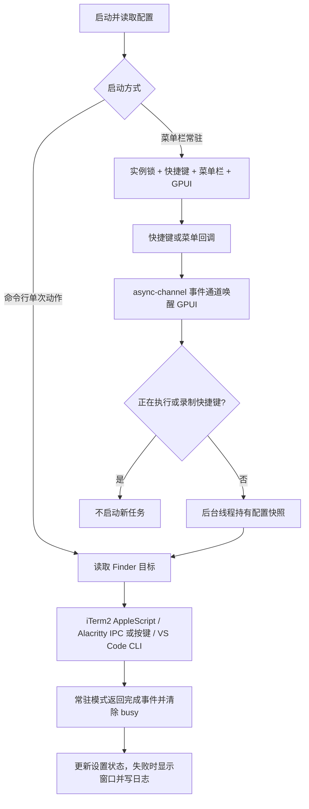

# FinderJump

FinderJump 是 macOS 菜单栏工具：按全局快捷键，把 Finder 当前选中的文件 / 文件夹（无选中项时取窗口目录）打开到 iTerm2、Alacritty 或 VS Code。Finder 不必位于前台。

项目使用 Rust + GPUI 0.2.2（Metal 渲染）+ global-hotkey + tray-icon。设置界面由 GPUI 绘制，不依赖 WebView、Electron 或 Tauri；Finder 和目标应用通过 AppleScript、IPC 或 CLI 连接。

## 目录

- [快速开始](#快速开始)
- [设计说明](#设计说明)
- [编译与打包](#编译与打包)
- [GitHub 自动打包与发布](docs/github-build.md)
- [使用说明](#使用说明)
- [配置说明](#配置说明)
- [命令行使用](#命令行使用)
- [当前方案的优缺点](#当前方案的优缺点)
- [故障排查](#故障排查)
- [开发与验收](#开发与验收)

## 快速开始

准备支持 Metal 的 macOS、Rust 工具链、Xcode Command Line Tools，以及准备使用的 iTerm2 / Alacritty / VS Code。项目声明最低 macOS 12.0、Rust 1.95，实际兼容范围还需在目标系统验收。

在项目根目录执行：

```bash
cargo test --locked
./scripts/bundle.sh
```

生成当前构建架构的 `dist/FinderJump.app`。将它复制到 `/Applications`，再启动：

```bash
# 更新已有安装前，先从菜单栏退出旧实例
# ditto 会写入目标安装目录
ditto dist/FinderJump.app /Applications/FinderJump.app
open /Applications/FinderJump.app
```

菜单栏出现 `⌘↗`，默认不显示设置窗口，打包应用声明 `LSUIElement`，并在 GPUI 启动后设置 AppKit `Accessory` 策略，隐藏 Dock 图标。

1. 在 Finder 打开一个实际目录。
2. 按 `Cmd+G`，默认在 iTerm2 打开该目录；按 `Cmd+E`，默认使用 VS Code 打开。
3. 首次调用时按系统提示授予自动化权限。
4. 菜单栏选择 **Preferences…** 修改终端、窗口行为和快捷键，再点击 **Save & Apply**。

默认快捷键是全局的，会占用其他应用中的同名组合键。关闭设置窗口仍会常驻，选择 **Quit FinderJump** 才完全退出。

## 设计说明

### 目标与范围

核心目标是减少“复制 Finder 路径、切换应用、输入 cd 或打开目录”的步骤，同时提供菜单栏入口、全局快捷键、设置持久化和登录启动。

当前只面向 macOS，支持 iTerm2、Alacritty 和 VS Code；没有任意应用插件接口、Finder 右键扩展、远程目录映射、自动升级或多任务队列。它获取的是 Finder 选中项目或窗口目录，而不是其他应用当前文件的位置。

### 模块划分

| 文件 | 职责 |
| --- | --- |
| `src/main.rs` | 命令行分派、读取配置、常驻实例锁、命令行启动与 GPUI 主循环分派、启动失败提示 |
| `src/app.rs` | 运行配置与编辑草稿、事件分派、忙碌状态、后台任务、错误显示与日志 |
| `src/menu.rs` | 原生菜单栏标题、菜单项及事件 ID |
| `src/settings.rs` | GPUI 设置表单、快捷键录制、保存与放弃修改 |
| `src/hotkeys.rs` | 全局快捷键注册、差量替换与失败回滚 |
| `src/config.rs` | TOML 默认值、解析、语义校验、临时文件替换保存 |
| `src/finder.rs` | 读取 Finder 目标、解析脚本输出、目录存在性检查 |
| `src/launcher.rs` | 终端 / 编辑器分派、可执行文件定位、应用启动策略 |
| `src/process.rs` | 子进程输出与退出码检查、AppleScript 参数传递、后台子进程回收 |
| `src/autostart.rs` | 用户 LaunchAgent 文件生成、删除与存在性检查 |
| `assets/*.applescript` | iTerm2 会话创建、Alacritty 原生 Tab 自动化 |
| `assets/Info.plist`、`assets/entitlements.plist` | Bundle 元数据、后台应用标记、Apple Events 签名权限 |
| `scripts/bundle.sh`、`scripts/icon.swift` | release 构建、图标生成、组装 `.app` 与签名验证 |
| `src/tests.rs` | 配置、路径、子进程等单元测试 |

### 启动和事件流



常驻模式在主线程创建 Cocoa 相关对象、快捷键管理器及窗口。原生回调将事件送入 `async-channel`，唤醒 GPUI 异步任务；任务在主线程消费事件，再通过 `Context::notify` 更新界面。项目自身没有定时轮询，也没有持续动画请求。

耗时的 Finder 查询和应用启动在工作线程执行，使用触发时的配置副本。终端与编辑器共用一个 `busy` 状态：一个动作未完成时，新动作直接忽略，不排队。设置仍可编辑，更新后的配置用于后续动作。后台启动 Alacritty 时另有等待线程回收子进程，它不代表用户需要等到终端退出才能再次触发。

设置窗口是 GPUI 根视图，关闭时取消真正关闭并隐藏应用窗口，保留事件循环和图形上下文。因此“窗口隐藏”不等于释放渲染资源。退出菜单才结束应用。

### Finder 目标选择规则

按以下顺序取值：

1. Finder 有选中项时，使用第一个选中的文件或文件夹。
2. 无选中项时，尝试把最前面的 Finder 窗口 `target` 转成真实目录路径。
3. 没有可映射的窗口目录时，回退到用户 HOME。
4. 检查目标是实际文件或目录；选中项失效、路径不可访问或授权失败时明确报错。

| Finder 状态 | 终端快捷键 | VS Code 快捷键 |
| --- | --- | --- |
| 选中文件夹 | 进入选中文件夹 | 打开选中文件夹 |
| 选中文件 | 进入文件所在目录 | 打开文件本身 |
| 未选中项目 | 进入 Finder 窗口目录 | 打开 Finder 窗口目录 |
| 无可用窗口目录 | 进入 HOME | 打开 HOME |

Finder 不必位于前台。搜索结果等虚拟目录中有真实选中项时仍优先使用选中项目；多个选中项只使用 Finder 返回的第一个项目，不批量启动应用。

AppleScript 执行失败（例如拒绝自动化权限）会直接报错，**不会**静默回退 HOME。路径解析只去掉脚本输出末尾的一个换行，保留路径本身的空格等字符。终端只接受工作目录，因此选中文件时使用其父目录。

### 应用适配策略

| 目标 | 调用方式 | 会话 / 窗口行为 |
| --- | --- | --- |
| iTerm2 | 按 Bundle ID 定位，使用 AppleScript 和默认 profile | 已运行且有窗口时新建 Tab；没有窗口时新建窗口；首次启动有窗口时复用启动窗口 |
| Alacritty `ipc` | `alacritty msg create-window --working-directory <目录>` | IPC 成功则激活应用；失败时尝试以 `--working-directory` 启动新实例 |
| Alacritty `native_tab` | 已运行时用 System Events 发送 `Cmd+T`，等待 0.4 秒，再输入 `cd` | 实验模式；未运行时直接用工作目录参数启动 |
| VS Code | 应用内 `code` CLI | `reuse_window = true` 使用 `--reuse-window`，否则使用 `--new-window` |

Alacritty 的 IPC 创建窗口，不保证创建原生 Tab；是否合并为 Tab 取决于系统和应用设置。Native tab 模式依赖默认快捷键、焦点和 shell 就绪时机，失焦检查也无法彻底消除输入竞争。

iTerm2 不模拟键盘输入，不需要辅助功能权限。但 iTerm2 和 Alacritty native tab 都会向会话发送 `cd -- <引用后的目录>`，需要兼容该命令的 shell（如 zsh/bash）；默认 profile 自动进入 SSH、tmux 或其他交互程序时，不能保证目录切换符合预期。

路径作为独立参数传给固定 AppleScript；脚本用 `quoted form` 生成 shell 引用。CLI 使用 `Command::arg` 传参，不把目录拼成 shell 命令。特殊字符处理不等于模拟键盘能可靠输入所有字符：Alacritty native tab 仍可能受中文、输入法和键盘布局影响。

### 配置更新与故障处理

内存中分别保存生效配置 `config` 和编辑草稿 `draft`。**Save & Apply** 的处理顺序是：

1. 验证配置和快捷键，先注册新增快捷键，再注销不再使用的旧快捷键。
2. 新键注册失败时尝试撤销新增注册，保留旧键；交换两个已有快捷键只交换动作映射。
3. 将配置写入同目录、带进程 ID 的临时文件，再 `rename` 替换目标文件。
4. 写盘失败时尝试恢复旧快捷键；成功后才更新内存中的生效配置和草稿。

这是带回滚的更新流程，不是操作系统级事务；底层注册、注销或回滚再次失败时仍可能需要重启。文件替换避免直接截断旧文件，但没有 `fsync` 掉电持久性保证，也不保留原 TOML 注释和排版。

**Reload Config** 也走应用与保存流程。解析失败时运行中的配置保持不变；若外部文件本身已被改坏，不会自动恢复磁盘文件。

常驻动作错误在设置窗口显示。设置中开启 **Enable diagnostic logging** 并保存后，操作结果和错误会追加到配置目录内的 `finderjump.log`；默认关闭，关闭后不再写入，也不会删除已有日志。**Show Log…** 可打开日志（尚不存在时创建空文件）。启动 / 命令行错误输出到 stderr；无参数启动失败还会尝试显示原生对话框。启动错误不保证写入该日志。日志没有轮转机制，可能包含本地路径。

### 单实例与登录启动

常驻模式通过配置目录内 `instance.lock` 的非阻塞 `flock` 排他锁阻止重复启动，进程退出即释放锁；磁盘上留下锁文件不等于仍有实例运行。`--terminal` / `--editor` 单次调用在获取实例锁前分派，可以与常驻实例同时执行，因此不受常驻进程的 `busy` 限制。

登录启动通过 `~/Library/LaunchAgents/com.finderjump.app.plist` 实现，写入当前 `.app` 内二进制的规范绝对路径，设置 `RunAtLoad = true`、`KeepAlive = false`。当前只写入或移除文件，没有调用 `launchctl` 立即加载，也没有采用 SMAppService；勾选状态只表示文件存在，不是系统已加载状态。

## 编译与打包

### GPUI 迁移

设置窗口和事件循环已迁移到固定版本 [GPUI 0.2.2](https://docs.rs/crate/gpui/0.2.2)；移除了 eframe / egui。Finder 查询、应用启动、配置格式、快捷键注册与回滚、日志和 LaunchAgent 逻辑继续复用。

启用 GPUI 的 `font-kit` 和 `runtime_shaders`，禁用默认的其他平台后端。Metal 着色器在运行时编译，因此本项目的构建不要求离线 `metal` / `metallib` 工具；首次创建窗口的开销需实测。此迁移不承诺降低内存或提升启动速度。

自定义 executable 改用 **Choose…** 原生文件选择器，可通过 `Cmd+Shift+G` 输入完整路径；**Automatic** 清除覆盖值。也可以通过 Open Config File 编辑 TOML 后 Reload Config。

### 环境准备

| 项目 | 要求或用途 |
| --- | --- |
| 操作系统 | macOS；Bundle 声明最低 12.0，仍需目标版本实测 |
| Rust | `Cargo.toml` 声明 Rust 1.95+，Edition 2024 |
| Apple 工具 | Xcode Command Line Tools，提供编译链及打包所需的 Swift 等工具 |
| 目标应用 | 运行对应功能时需安装 iTerm2 / Alacritty / VS Code；不是编译依赖 |
| 网络 | 首次下载 Cargo 依赖需要访问依赖源；缓存齐全后可使用 Cargo 离线选项 |

若缺少 Apple 命令行工具，执行 `xcode-select --install`，完成系统安装后检查环境：

```bash
xcode-select -p
rustc --version
cargo --version
xcrun --find swift
```

仓库提交了 `Cargo.lock`，日常构建使用 `--locked` 保持依赖解析一致。若修改 `Cargo.toml` 导致锁文件不匹配，应有意更新并审查 `Cargo.lock`，不要在发布构建中直接去掉 `--locked` 绕过问题。

### 开发运行与 release 二进制

```bash
# 调试构建与运行；首次加载配置可能创建用户配置文件
cargo build --locked
cargo run --locked -- --preferences

# release 二进制：target/release/finder-jump
cargo build --release --locked
./target/release/finder-jump --help
```

release 配置启用 thin LTO、单个 codegen unit 和符号剥离。直接运行二进制适合调试，但不会自动得到 `.app` 的 Bundle 元数据、`LSUIElement` 和签名上下文；实际菜单栏、权限及登录启动验收应使用打包应用。登录启动开关会拒绝不位于 `.app/Contents/MacOS/` 下的可执行文件。

### 生成 `.app`

```bash
./scripts/bundle.sh
```

脚本依次执行：

1. 切换到项目根目录，设置 `MACOSX_DEPLOYMENT_TARGET=12.0`。
2. 运行 `cargo build --release --locked`。
3. 把二进制复制到 `dist/FinderJump.app/Contents/MacOS/`。
4. 用 Swift 生成 iconset，再用 `iconutil` 转成 `.icns`。
5. 复制 `Info.plist` 和示例配置；执行 `plutil -lint`。
6. 使用 `--options runtime` 和 Apple Events entitlement 签名，再用 `codesign --verify --deep --strict` 检查。

输出结构：

```text
 dist/FinderJump.app/
 └── Contents/
     ├── Info.plist
     ├── MacOS/finder-jump
     └── Resources/
         ├── FinderJump.icns
         └── config.example.toml
```

AppleScript 通过 `include_str!` 编译进二进制，不需要随包单独复制。Resources 下的配置只是示例，实际用户配置在 Application Support 中。

脚本默认构建本机工具链对应架构，**不会生成 Universal Binary**。当前固定从 `target/release/finder-jump` 复制文件，不支持直接通过 `--target` 或 `CARGO_BUILD_TARGET` 切换产物路径。跨架构发布需要另行调整构建 / 复制流程，并在目标机器验证；使用 Rosetta 工具链时尤其要检查实际架构。

```bash
file dist/FinderJump.app/Contents/MacOS/finder-jump
plutil -lint dist/FinderJump.app/Contents/Info.plist
codesign --verify --deep --strict dist/FinderJump.app
```

版本号目前分别写在 `Cargo.toml` 和 `assets/Info.plist`，脚本不会自动同步。发布前需一起检查 `CFBundleShortVersionString` 与 `CFBundleVersion`。

### 签名与分发边界

未设置 `CODESIGN_IDENTITY` 时，脚本使用 `-` 做 ad-hoc 签名，适合本机构建使用，不等于 Developer ID 签名或 Apple 公证。

如已有有效 Developer ID Application 证书，可指定身份打包：

```bash
CODESIGN_IDENTITY='Developer ID Application: Your Name (TEAMID)' ./scripts/bundle.sh
```

当前脚本只负责构建、Bundle 组装、签名与签名结构验证，**不负责公证、staple、DMG / PKG、发布上传或自动更新**。面向其他用户分发时仍需单独完成公证及目标机器的 Gatekeeper 验收。`codesign --verify` 通过不能替代这些步骤。重新签名、替换或移动应用后，也应重新检查自动化授权与登录启动路径。

### GitHub 自动打包与发布

`.github/workflows/build-macos.yml` 在 main/master 提交、PR 和手动运行时生成 arm64 / x86_64 应用包；推送与 Cargo 版本一致的 `v*` 标签后，双架构检查与打包全部成功才自动发布 GitHub Release。`scripts/package-macos.sh` 提供 ZIP 和 SHA-256，`scripts/publish-release.sh` 支持草稿恢复及完整附件发布。详细触发规则、发布步骤、本地命令与权限说明见 [自动打包文档](docs/github-build.md)。

## 使用说明

### 菜单栏与设置

| 入口 | 行为 |
| --- | --- |
| `Cmd+G` / **Open Terminal** | 按当前终端配置打开选中文件夹；文件使用父目录 |
| `Cmd+E` / **Open VS Code** | 按当前窗口策略使用 VS Code 打开选中文件或文件夹 |
| **Preferences…** | 显示并聚焦设置窗口 |
| **Reload Config** | 从磁盘读取配置并尝试应用，会覆盖未保存的设置草稿 |
| **Open Config File** | 用系统文本编辑器打开配置文件 |
| **Show Log** | 用系统文本编辑器打开日志 |
| **Quit FinderJump** | 退出常驻进程并释放快捷键 |

点击快捷键按钮开始录制，按下所需组合键，Escape 取消。支持 Command、Control、Option、Shift 组合；界面录制要求至少包含 Command / Control / Option 之一。录制期间不执行打开动作。手写配置采用相同限制。重复快捷键会即时提示；**Restore default shortcuts** 恢复默认组合，保存后生效。

**Save & Apply** 保存终端、编辑器、快捷键和日志配置；**Discard changes** 恢复当前生效配置。**Launch at login** 独立于 TOML，勾选后立即写入 / 删除 LaunchAgent，不需要点击保存，也不会被 Discard changes 撤销。

### 权限与目标应用

- 所有打开动作都要读取 Finder，首次使用按提示允许自动化控制 Finder。
- iTerm2 还需要对应自动化控制授权，不需要辅助功能权限。
- Alacritty native tab 使用 System Events，需要对应自动化授权及辅助功能权限。
- 可在「系统设置 → 隐私与安全性 → 自动化 / 辅助功能」检查权限；旧版 macOS 的界面名称可能不同。

应从最终安装位置运行并授权，避免同时运行调试二进制与已安装 `.app`，造成实例或权限身份混淆。

Alacritty IPC 模式需要目标实例允许 IPC；与本项目调用方式匹配的配置示例如下，具体配置格式需与所安装的 Alacritty 版本对应：

```toml
[general]
ipc_socket = true
```

VS Code 使用其应用包内的 `code` CLI，无需额外安装 PATH 命令。找不到 CLI 会明确报错，不使用可能丢失窗口复用语义的 LaunchServices 降级方案。

### 登录启动、升级与卸载

1. 把 `.app` 放在固定安装目录后启动，进入设置勾选 **Launch at login**。
2. 该变更在下次登录生效，不会立即重启进程；崩溃后也不会自动重启。
3. 升级时先退出旧实例，再替换 `.app`。相同用户配置会保留。
4. 移动安装位置后，关闭再开启登录启动，以更新 plist 中的绝对路径。
5. 卸载前取消登录启动、退出应用，再删除 `.app`。若应用已删除，可手动移除 `~/Library/LaunchAgents/com.finderjump.app.plist`。
6. 要清除配置及日志，再删除 `~/Library/Application Support/FinderJump`；仅删除 `.app` 不会清理这些用户数据。

## 配置说明

路径为 `~/Library/Application Support/FinderJump/config.toml`，加载时不存在会自动创建默认值。完整示例见 [config.example.toml](config.example.toml)。

```toml
[hotkeys]
terminal = "cmd+g"
editor = "cmd+e"

[terminal]
kind = "iterm2"
alacritty_mode = "ipc"
# executable = "/Applications/Alacritty.app/Contents/MacOS/alacritty"

[editor]
kind = "vscode"
reuse_window = true
# executable = "/Applications/Visual Studio Code.app/Contents/Resources/app/bin/code"
```

| 字段 | 默认值 | 说明 |
| --- | --- | --- |
| `logging.enabled` | `false` | 是否写入本地诊断日志，关闭后保留已有日志 |
| `hotkeys.terminal` | `cmd+g` | 终端快捷键，不能与编辑器快捷键等价或重复 |
| `hotkeys.editor` | `cmd+e` | 编辑器快捷键，必须带修饰键 |
| `terminal.kind` | `iterm2` | 仅 `iterm2` / `alacritty` |
| `terminal.alacritty_mode` | `ipc` | 仅 `ipc` / `native_tab`，选择 Alacritty 时使用 |
| `terminal.executable` | 未设置 | Alacritty 可执行文件绝对路径；iTerm2 分支不使用此值 |
| `editor.kind` | `vscode` | 当前仅支持 `vscode` |
| `editor.reuse_window` | `true` | `false` 时新建 VS Code 窗口 |
| `editor.executable` | 未设置 | VS Code 的 `code` CLI 绝对路径，不是 `.app` 目录 |

可省略字段或整个配置节以使用默认值；未知字段、未知应用类型 / 模式、非法或重复快捷键会被拒绝。两个快捷键的字符串不同但解析结果相同时，也视为重复。

Alacritty / VS Code 的可执行文件按以下优先级查找：

1. 显式配置的非空路径：必须是绝对路径、普通文件且具有执行权限，否则报错，不继续自动查找。
2. `/Applications` 中的标准应用包路径。
3. `~/Applications` 中的标准应用包路径。
4. `/opt/homebrew/bin`、`/usr/local/bin`、`/usr/bin`。
5. 当前进程 `PATH` 的各个目录。

`~` 和环境变量不会在配置字符串中展开；请填写实际绝对路径。显式路径存在性在执行对应动作时检查，保存配置或 `--check-config` 成功不代表应用一定可启动。

外部修改配置后需要 **Reload Config** 或重启，没有配置文件监听器。成功保存 / 重载会重新序列化 TOML，补齐默认值并移除原注释。

## 命令行使用

以下命令使用 release 二进制；安装后也可替换为 `/Applications/FinderJump.app/Contents/MacOS/finder-jump`。

```bash
# 不启动 UI；前两项不加载用户配置
./target/release/finder-jump --help
./target/release/finder-jump --print-config-path

# 加载并验证配置；配置不存在时会生成默认文件
./target/release/finder-jump --check-config

# 执行一次并退出，可能请求系统自动化权限
./target/release/finder-jump --terminal
./target/release/finder-jump --editor

# 启动常驻进程并立即显示设置窗口
./target/release/finder-jump --preferences
```

无参数启动菜单栏常驻模式。上述选项按单个操作使用；程序没有通用子命令解析器，也不支持命令行直接指定目标目录。已有常驻实例时，`--preferences` 不会给它发消息，而是因实例锁失败；请从菜单栏打开设置。

`--check-config` 只验证配置解析与语义，不注册快捷键，也不检查目标应用、可执行路径、权限或实际打开效果。单次调用错误输出到 stderr，失败退出码为 1。

## 当前方案的优缺点

| 设计选择 | 优点 | 代价与限制 |
| --- | --- | --- |
| Rust + GPUI | 无浏览器运行时，核心逻辑与设置界面使用同一语言，部署为单个 `.app` | 隐藏窗口仍保留图形上下文；GPUI 仍处于 1.0 之前，升级可能有破坏性变更；控件并非 AppKit 原生控件 |
| 事件唤醒 + 后台线程 | 项目无需周期轮询 Finder，耗时启动不阻塞设置界面的正常交互 | 没有实测内存 / CPU / 启动延迟基线，不能据此承诺零开销或固定性能优势 |
| AppleScript 读取 Finder / 控制 iTerm2 | 不需 Finder 扩展，iTerm2 无需模拟按键，代码和部署相对直接 | 仅限 macOS，依赖应用脚本接口和用户授权，虚拟目录只能尽力回退 |
| Alacritty IPC | 通过参数传目录，减少焦点和键盘输入依赖 | 创建窗口而非保证 Tab；IPC 失败会尝试新实例，未必满足“只在现有实例新建会话”的要求 |
| Alacritty 原生 Tab 自动化 | 在现有应用中尝试创建原生 Tab | 0.4 秒固定等待，不验证 shell 就绪；焦点、键位、输入法和复杂 profile 都会影响可靠性 |
| VS Code CLI | 明确保留复用 / 新建窗口语义 | 依赖可用 CLI，仅支持当前适配的 VS Code，不自动适配所有编辑器分支 |
| TOML + 差量快捷键更新 | 可手工管理配置，校验拼写，更新失败尽量保留旧状态 | 保存不保留注释；没有文件监听；回滚仍可能失败，也没有跨进程配置事务 |
| 单实例 + busy 去重 | 避免重复常驻注册，抑制同一次未完成动作期间的连击 | 忙碌时丢弃操作；没有队列、取消按钮或统一子进程超时；卡住的调用可能长期占用 busy |
| LaunchAgent 登录启动 | 实现直接，文件和启动路径容易检查 | 需固定安装路径，下次登录生效，无立即加载、崩溃保活或 SMAppService 管理 |
| 本地脚本打包 | 构建流程可读，提供图标、元数据、签名及验证 | 单架构，版本号手工同步，未集成公证、安装器、自动升级和分发流水线 |

当前方案适合“个人 macOS 桌面上，把 Finder 选中项目或目录送到少数固定应用”的场景。需要可靠批量调度、任意终端插件、跨平台运行或完善商业分发时，需要扩展现有架构与发布流程。

此外，后台启动 Alacritty 的 stdout / stderr 被丢弃，创建进程成功不代表应用后续初始化或目录切换一定成功；iTerm2 脚本成功也不等于已经验证 shell 的最终工作目录。真实会话结果仍要人工确认。

## 故障排查

| 现象 | 检查与处理 |
| --- | --- |
| 构建提示 Rust 版本不足 | 对照 `rustc --version` 与 `Cargo.toml` 的 `rust-version`，使用满足要求的工具链 |
| `--locked` 构建失败 | 查看完整错误，区分锁文件不匹配与依赖下载失败；修复依赖 / 缓存，不跳过锁定验证 |
| Swift、iconutil 或签名步骤失败 | 检查 Command Line Tools、脚本报错和指定证书；签名失败不能当作打包成功 |
| 提示 `FinderJump is already running` | 使用现有菜单栏实例；升级或调试前先退出它，不要靠删除锁文件解决 |
| 全局快捷键无效或提示不可用 | 打开设置检查冲突，改用其他组合；配置检查成功不代表系统注册一定成功 |
| Finder / iTerm2 自动化被拒绝 | 检查最终安装应用的自动化权限，再重试；拒绝授权不会回退 HOME |
| 打开 HOME 或与选中项不一致 | 对照 Finder 目标优先级；优先取选中项目；终端对文件使用父目录，无选中项时取窗口目录 |
| `Cannot find code` / `Cannot find alacritty` | 确认应用已安装，或指定真实可执行文件的绝对路径 |
| `Invalid executable` | 不填写 `.app` 目录、相对路径、`~` 路径或不可执行文件；显式错误不会自动降级 |
| Alacritty 打开新窗口而非 Tab | IPC 的设计行为；native tab 才会模拟 `Cmd+T`，且有额外权限与时序限制 |
| native tab 未切换目录或输入异常 | 检查辅助功能、默认键位、焦点、shell/profile；可改用 IPC |
| 一直显示 `Opening Finder target…` | 检查被调用应用和权限对话框；当前无统一超时，可退出后重启 FinderJump |
| 登录启动没有生效 | 确认 plist 存在且二进制路径有效，下次登录验证；移动应用后重新切换开关 |
| 外部改配置后无变化 | 点击 Reload Config，查看设置错误和 Show Log；解析失败时旧运行配置仍生效 |

## 开发与验收

本次迁移的风险清单、实测范围及待验收项目见 [GPUI 验收记录](tests/gpui-acceptance.md)。

常规检查命令：

```bash
cargo fmt --check
cargo clippy --all-targets --locked -- -D warnings
cargo test --locked
./scripts/bundle.sh
git diff --check
```

当前 `src/tests.rs` 的测试，覆盖配置序列化往返、部分配置默认值、未知字段 / 模式、等价重复及无修饰键快捷键、特殊路径解析、无效配置保存保留旧文件、显式可执行路径校验、AppleScript 参数隔离和子进程失败诊断。其中 AppleScript 参数测试需要 macOS 的 `/usr/bin/osascript`，但不控制 Finder 或目标终端。

这些测试没有覆盖真实全局快捷键注册与回滚、UI 生命周期、TCC 授权、登录启动，以及真实终端 / 编辑器结果。以下项目需要在用户桌面会话中人工验收；文档列出的步骤不是已通过的兼容性声明：

1. 从最终安装目录启动，只出现菜单栏；打开 / 关闭 / 再次打开设置；退出后快捷键被释放。
2. Finder 分别打开含空格、中文、单引号的目录，确认终端 `pwd` 和编辑器目录；测试无窗口、虚拟目录及没有可用选择的回退。
3. 对 iTerm2 / Alacritty 测试未运行、有窗口、已运行但无窗口，核对会话数量与目标目录。
4. 分别测试 Alacritty IPC、IPC 不可用降级、native tab 授权 / 失焦 / 复杂 profile。
5. 修改、交换两个快捷键，制造冲突，验证新键生效或旧键保留；忙碌期间快速重复触发，确认不会排队。
6. 测试 VS Code 复用 / 新建窗口；指定错误路径，确认明确报错而不改用其他应用。
7. 拒绝并恢复自动化权限，核对设置窗口和日志；外部写入错误 TOML 后重载，确认运行配置保留。
8. 勾选登录启动后重新登录，确认启动；取消后重新登录，确认不再启动；移动应用后更新路径并复验。
9. 在计划支持的 macOS 版本和 CPU 架构上验证安装、签名、权限及真实应用兼容性。
